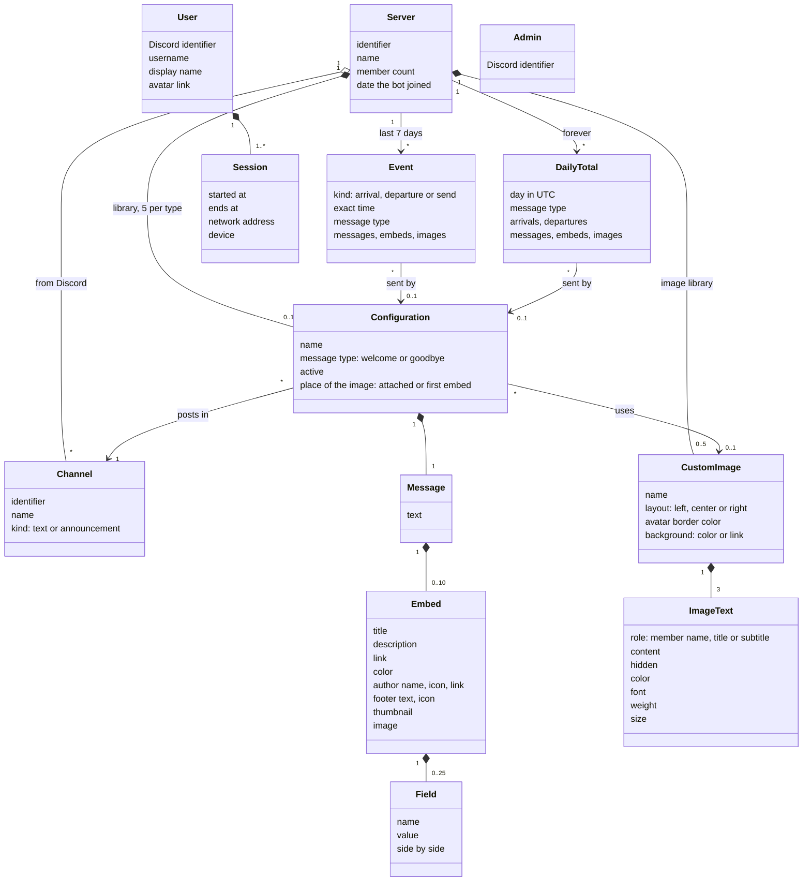

# Domain model

The business objects of Welcomer, what they hold and how they relate. This is a conceptual model, in domain words: it says nothing about how data is stored. The technical data model implements it.

## Diagram

## Objects

| Object        | Meaning                                                                                    | Lives                                               | Rules                     |
| ------------- | ------------------------------------------------------------------------------------------ | --------------------------------------------------- | ------------------------- |
| Server        | A Discord server where the bot is present.                                                 | from the bot's arrival to its departure             | R-SRV-1 to R-SRV-6        |
| Channel       | A text or announcement channel of the server. Discord owns it; Welcomer only points to it. | as long as it exists on Discord                     | R-CFG-8, R-CFG-16         |
| Configuration | What the bot posts for one message type.                                                   | from validation to deletion, or the bot's departure | R-CFG-5 to R-CFG-17       |
| Message       | The text and embeds of a configuration.                                                    | with its configuration                              | R-MSG-1 to R-MSG-10       |
| Embed, Field  | The parts of a message.                                                                    | with their message                                  | R-MSG-1 to R-MSG-7        |
| CustomImage   | A picture design of the image library.                                                     | from validation to deletion, or the bot's departure | R-IMG-1 to R-IMG-18       |
| ImageText     | One of the three texts of an image: the member name, the title, the subtitle.              | with its image                                      | R-IMG-10 to R-IMG-14      |
| Event         | One arrival, departure or send, with its exact time. Nothing about the member.             | 7 days                                              | R-STA-1 to R-STA-3        |
| DailyTotal    | The events of one day, counted together.                                                   | forever, even after the bot leaves                  | R-STA-4                   |
| User          | A person who signed in with Discord.                                                       | until their last session ends                       | R-ACC-1, R-PRV-1, R-PRV-3 |
| Session       | One device where the user is signed in.                                                    | 7 days, extended by use; ends at sign-out           | R-ACC-3, R-ACC-4          |
| Admin         | A member of the Welcomer team, known by their Discord identifier.                          | while they are an admin                             | R-ADM-1, R-ADM-2          |

## Notes

- A server manager is not an object: being a manager is checked on Discord each time (R-ACC-5 to R-ACC-7).
- A draft is not an object: it exists only on the screen until it is validated (R-EDT-5).
- A configuration whose image was deleted simply uses no image (R-IMG-3).
- When a configuration is deleted, its events and daily totals stay, counted in the totals of their server and message type only (R-STA-17).
- When the bot leaves, the server's configurations and images go, its events and daily totals stay (R-SRV-5).
- Technical logs are not business objects; they are described in [privacy](./privacy.md).
