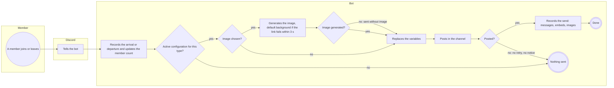
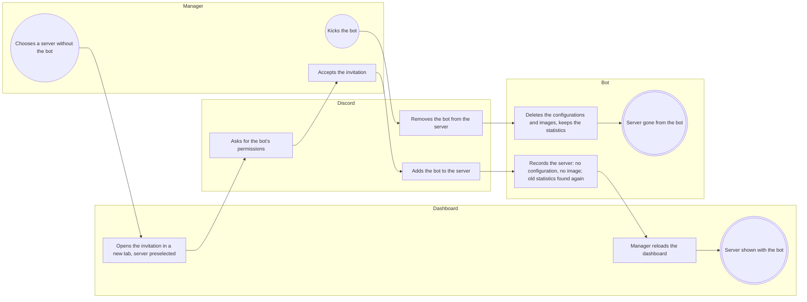
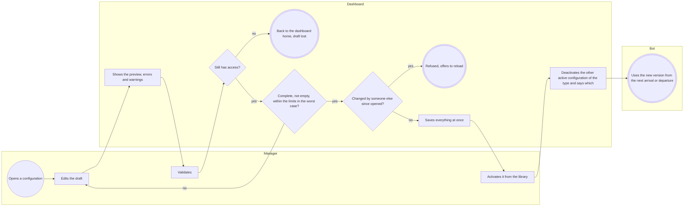

# Business processes

The three processes where several actors hand work to each other. They are drawn in the style of BPMN: one lane per actor, a circle for the start and a double circle for the end, a diamond for a decision. Journeys with a single actor are described in [journeys](./journeys.md) instead.

## P1 — Member arrival or departure

Rules: R-CFG-2, R-CFG-3, R-SRV-4, R-IMG-4, R-IMG-5, R-IMG-18, R-VAR-1, R-STA-5 to R-STA-8.

## P2 — Bot arrival on a server and departure

Rules: R-SRV-1 to R-SRV-6, R-ACC-10.

## P3 — Edit, validate and activate a configuration

Activating is optional and can happen later, at any time; a configuration that was already active needs no activation and the bot uses the new version at once.

Rules: R-ACC-7 to R-ACC-9, R-CFG-9, R-CFG-12, R-CFG-13, R-EDT-1 to R-EDT-9, R-MSG-6 to R-MSG-9.
