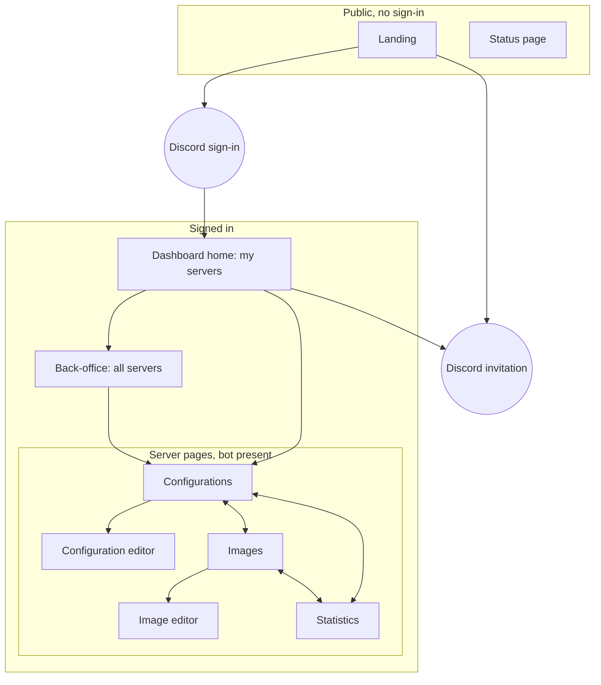

# Screen map

The screens of the product, what each one shows, and how a person moves between them. Addresses of the pages are in the [technical architecture](../technical/architecture.md#54-dashboard-pages).

## Map

On every page, a header shows: the Welcomer name, a link to the status page, a link to the support server, and either "Sign in" or the signed-in user with "Sign out". The back-office link shows only to admins.

## Screens

| Screen               | Who                     | Shows                                                                                                         | Actions                                                     | Rules                       |
| -------------------- | ----------------------- | ------------------------------------------------------------------------------------------------------------- | ----------------------------------------------------------- | --------------------------- |
| Landing              | anyone                  | presentation of the bot and its features                                                                      | invite the bot, sign in                                     | R-PUB-1                     |
| Status page          | anyone                  | overall state, total servers, running since; one line per Discord connection                                  | search a server identifier                                  | R-PUB-4 to R-PUB-9          |
| Dashboard home       | user                    | the servers the user manages, those with the bot first; a message when there are none                         | open a server, invite the bot to a server without it        | R-ACC-10, R-ACC-11, R-SRV-1 |
| Configurations       | server manager, admin   | the configurations of each type in creation order, the active one highlighted, a missing channel shown as not found | create, open, activate, deactivate, delete              | R-CFG-6 to R-CFG-17         |
| Configuration editor | server manager, admin   | name, channel, text, embeds, variables to insert, image and its place, live preview, errors and warnings      | validate, cancel                                            | R-MSG-1 to R-MSG-10, R-VAR-1 to R-VAR-4, R-EDT-1 to R-EDT-9, R-IMG-19 |
| Images               | server manager, admin   | the images of the library, and which configurations use each one                                              | create, open, delete                                        | R-IMG-1 to R-IMG-3          |
| Image editor         | server manager, admin   | name, layout, avatar border, texts and their style, background, live preview                                  | validate, cancel                                            | R-IMG-6 to R-IMG-18, R-EDT-5 to R-EDT-9 |
| Statistics           | server manager, admin   | charts of arrivals and departures, totals and balance, sends per configuration and per type; days in UTC       | choose period, message type, configuration                  | R-STA-10 to R-STA-17        |
| Back-office          | admin                   | the servers where the bot is present, 50 per page                                                             | search by name or identifier, open a server                 | R-ADM-1 to R-ADM-6          |

Server pages show the server's icon and name, a link back to the dashboard home, and three tabs: Configurations, Images, Statistics.

Any server page sends a person without access back to the dashboard home (R-ACC-9). The back-office sends a non-admin back to the dashboard home (R-ADM-1).
