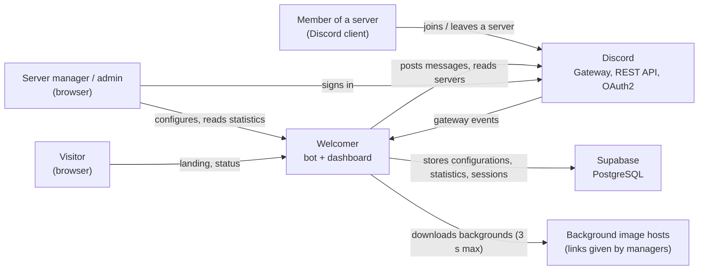
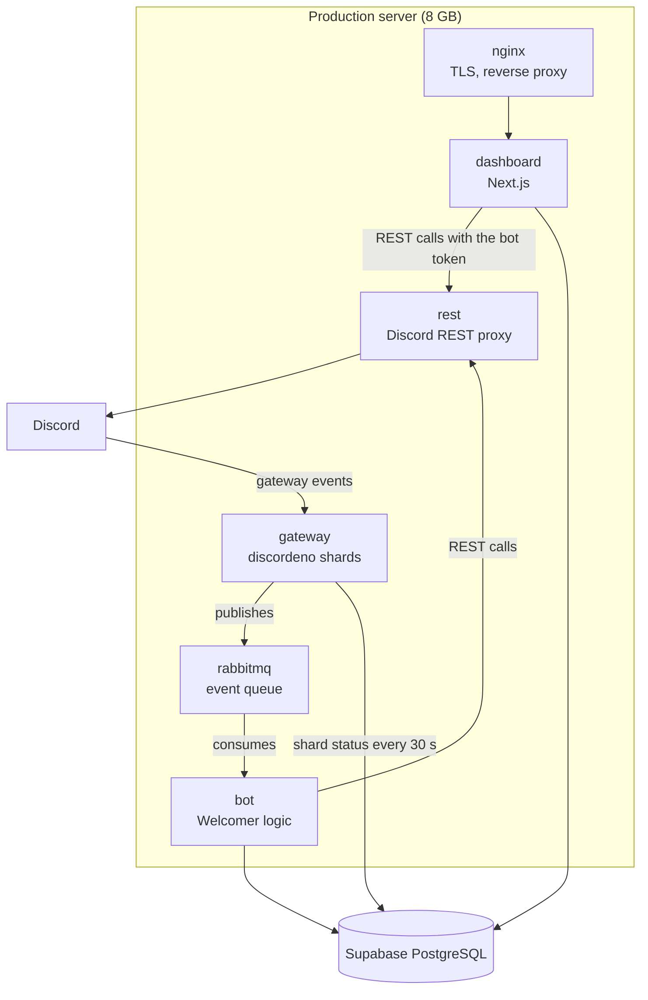
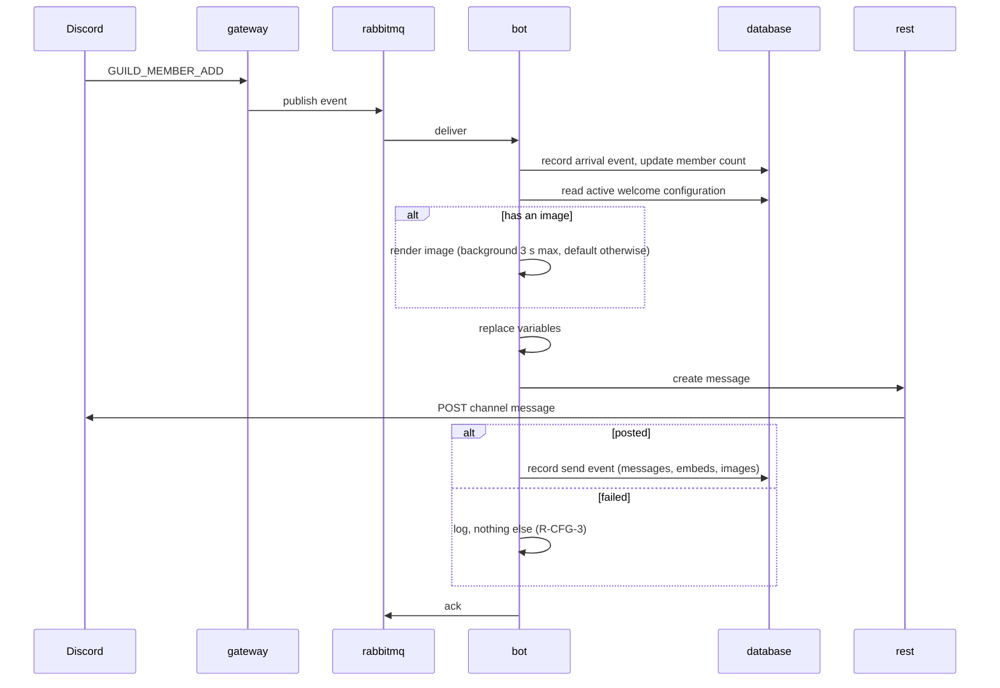
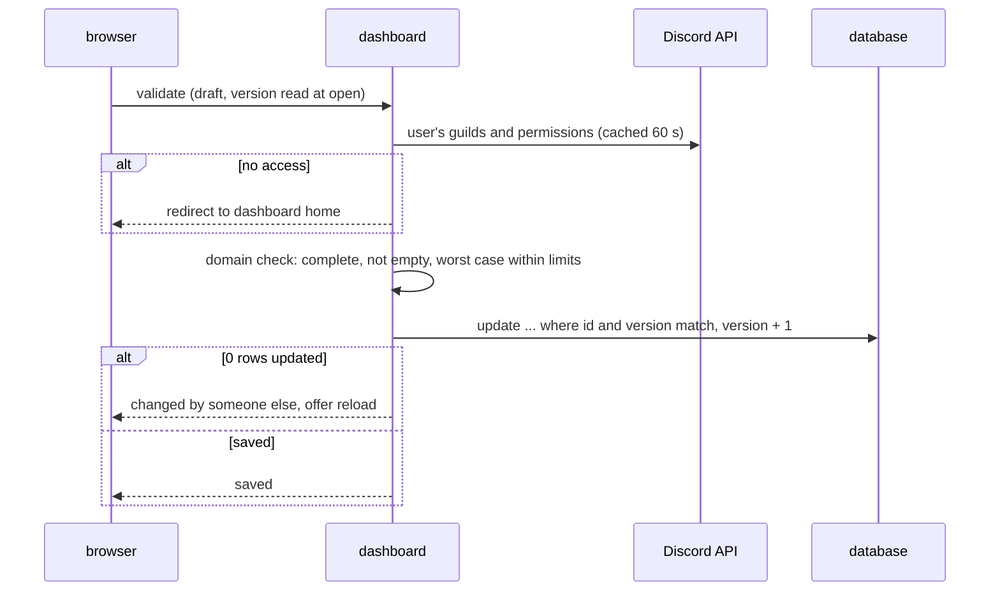

# Welcomer — architecture

Structure of this document: the arc42 template, tailored ([arc42 overview](https://arc42.org/overview): "Twelve sections, each with a clear purpose, tailorable to your specific needs"). Diagrams follow the C4 model ([c4model.com](https://c4model.com/)): system context, containers, then components where useful. Each decision is recorded as an ADR in [`../adr/`](../adr/README.md). Business rules live in [`../business/`](../business/); this document links to the rules it implements by their identifier (R-…).

## 1. Introduction and goals

Welcomer is a Discord bot that posts welcome and goodbye messages, with a web dashboard where server managers configure those messages and follow statistics ([requirements](../requirements.md)).

**Quality goals**, in priority order:

| #   | Goal            | Meaning                                                                                      | Source                                                                  |
| --- | --------------- | -------------------------------------------------------------------------------------------- | ----------------------------------------------------------------------- |
| 1   | Availability    | The bot is never interrupted for more than a few seconds, updates included.                  | [requirements, non-functional](../requirements.md#non-functional-needs) |
| 2   | Correctness     | A validated message never fails because of a Discord limit (worst-case check).               | R-MSG-7, R-MSG-8                                                        |
| 3   | Maintainability | Standard tools used the documented way; business rules in domain code, tested by their rule. | owner rule: official recommendations first                              |
| 4   | Frugality       | 100,000 servers on one 8 GB server.                                                          | [requirements](../requirements.md#non-functional-needs)                 |
| 5   | Privacy         | Only the personal data listed in R-PRV-1, for the listed time.                               | R-PRV-1 to R-PRV-11                                                     |

## 2. Constraints

- One server with 8 GB of memory; the database is hosted separately, on Supabase ([ADR-0005](../adr/0005-supabase-postgres-with-prisma.md)).
- No code is reused from earlier attempts: the repository starts empty.
- English only.
- Discord rules: rate limits, Developer Policy (data used only for the stated functions).
- A few seconds of dashboard downtime per update are accepted; a single dashboard instance ([ADR-0004](../adr/0004-nextjs-dashboard-behind-nginx.md)).

## 3. Context and scope



| Neighbour        | Exchange                                                                                                                        |
| ---------------- | ------------------------------------------------------------------------------------------------------------------------------- |
| Discord Gateway  | member add/remove, guild create/delete, interactions (commands)                                                                 |
| Discord REST API | create message, read channels and permissions, interaction replies                                                              |
| Discord OAuth2   | sign-in with scopes `identify` and `guilds`; no `email` scope (R-ACC-1, [ADR-0006](../adr/0006-better-auth-discord-sign-in.md)) |
| Supabase         | the only database                                                                                                               |
| Background hosts | HTTP GET of the manager's background link when an image is generated (R-IMG-16, R-IMG-18)                                       |

## 4. Solution strategy

| Need                                            | Approach                                                                                                                                       | ADR                                                        |
| ----------------------------------------------- | ---------------------------------------------------------------------------------------------------------------------------------------------- | ---------------------------------------------------------- |
| Rules shared by bot and dashboard               | One monorepo; the rules live once in shared packages (`domain`, `card`)                                                                        | [0002](../adr/0002-monorepo-yarn-turborepo.md)             |
| Bot never down more than seconds                | discordeno's three processes: gateway (holds Discord connections), rest (proxy), bot (logic); events queued in RabbitMQ while the bot restarts | [0003](../adr/0003-discordeno-three-processes-rabbitmq.md) |
| Dashboard                                       | Next.js App Router, one instance behind nginx                                                                                                  | [0004](../adr/0004-nextjs-dashboard-behind-nginx.md)       |
| Data                                            | PostgreSQL on Supabase through Prisma; one schema package                                                                                      | [0005](../adr/0005-supabase-postgres-with-prisma.md)       |
| Sign-in                                         | Better Auth with the Discord provider, default session settings                                                                                | [0006](../adr/0006-better-auth-discord-sign-in.md)         |
| Run and deliver                                 | Docker images on GHCR, one Compose file on the server, quality gate before any image; deploying comes later                                    | [0007](../adr/0007-compose-deploy-per-unit.md)             |
| Statistics at scale                             | Events table partitioned by day, dropped after 7 days; daily totals updated in the same transaction                                            | [0008](../adr/0008-statistics-events-and-daily-totals.md)  |
| Same image in preview and in Discord            | One rendering package used by the bot and by the dashboard preview                                                                             | [0009](../adr/0009-shared-card-rendering.md)               |
| Dashboard look without design work              | HeroUI v3, default theme                                                                                                                       | [0010](../adr/0010-heroui-default-theme.md)                |
| Message preview like Discord, nothing hand-made | Skyra Discord components with discord-markdown-parser (proposed)                                                                               | [0011](../adr/0011-discord-message-preview.md)             |

## 5. Building block view

### 5.1 Containers (C4 level 2)



| Container | Responsibility                                                                         | Image                   |
| --------- | -------------------------------------------------------------------------------------- | ----------------------- |
| nginx     | TLS termination, reverse proxy to the dashboard                                        | official nginx image    |
| dashboard | public pages, dashboard, back-office, sign-in, previews                                | dashboard image         |
| gateway   | Discord connections (shards); publishes events; writes shard status (R-PUB-6)          | bot image               |
| rabbitmq  | holds gateway events while the bot restarts                                            | official RabbitMQ image |
| bot       | handles events and commands, sends messages, generates images, records statistics      | bot image               |
| rest      | single point for Discord REST calls and their rate limits, shared by bot and dashboard | bot image               |

### 5.2 Repository layout

```
apps/
  bot/            gateway, rest and bot entry points (one image, three commands)
  dashboard/      Next.js app
packages/
  domain/         business rules shared by both apps: message model, limits, variables, worst-case check, statistics counting
  card/           custom image rendering (R-IMG-6 to R-IMG-18)
  database/       Prisma schema, migrations, generated client
  config-*/       shared TypeScript and ESLint configuration
docs/
  business/  technical/  adr/
```

### 5.3 Layers inside each app

| Layer                              | Holds                                                                            | May use                       |
| ---------------------------------- | -------------------------------------------------------------------------------- | ----------------------------- |
| handlers / routes / server actions | input parsing, authorization check, call one service, map errors to a reply      | services                      |
| services                           | business use cases, with domain types; throw domain errors                       | domain package, repositories  |
| repositories                       | reads and writes; map database and Discord types to domain types at the boundary | database package, rest client |

Domain types never depend on Prisma or Discord types; mapping happens in repositories (global rule: separate types, mapped at the boundary).

### 5.4 Dashboard pages

Routes of the App Router, with dynamic segments in brackets ([Next.js, dynamic routes](https://nextjs.org/docs/app/api-reference/file-conventions/dynamic-routes)). Screens are in the [screen map](../business/screens.md).

| Route                                                  | Screen                                                                                    |
| ------------------------------------------------------ | ----------------------------------------------------------------------------------------- |
| `/`                                                    | landing page                                                                              |
| `/dashboard`                                           | dashboard home (server list)                                                              |
| `/servers/[serverId]`                                  | redirects to its configurations                                                           |
| `/servers/[serverId]/configurations`                   | configurations library                                                                    |
| `/servers/[serverId]/images`                           | image library                                                                             |
| `/servers/[serverId]/configurations/new`               | new configuration                                                                         |
| `/servers/[serverId]/configurations/[configurationId]` | configuration editor                                                                      |
| `/servers/[serverId]/images/new`                       | new custom image                                                                          |
| `/servers/[serverId]/images/[imageId]`                 | custom image editor                                                                       |
| `/servers/[serverId]/statistics`                       | statistics                                                                                |
| `/status`                                              | status page                                                                               |
| `/admin`                                               | back-office server list                                                                   |
| `/api/auth/[...all]`                                   | Better Auth handler                                                                       |
| `/api/health`                                          | health check                                                                              |
| `/api/admin/servers`                                   | back-office suggestions (GET)                                                             |
| `/api/servers/[serverId]/card-preview`                 | image preview: POST of the draft image as JSON, answers a PNG (ADR-0009); changes nothing |

## 6. Runtime view

### 6.1 Member joins (P1, R-CFG-2, R-STA-5)



### 6.2 Manager validates a configuration (P3, R-EDT-8, R-EDT-9)



### 6.3 Status page (R-PUB-4 to R-PUB-9)

The gateway writes, every 30 seconds, one row per shard: state, latency, server count, last update. The status page reads those rows; a row older than 1 minute shows the shard offline. The shard of a server is computed with Discord's formula `shard_id = (guild_id >> 22) % num_shards` ([Discord, Sharding](https://docs.discord.com/developers/events/gateway#sharding)); confirmed in slice 1 (D16).

## 7. Deployment view

See [operations](./operations.md) for procedures and [CI](./ci-cd.md) for pipelines.

- One Linux server runs Docker Compose with: nginx, dashboard, gateway, rabbitmq, bot, rest. Each service has a memory limit and a healthcheck.
- Images: one for `apps/bot` (three services, three commands), one for `apps/dashboard`, built with `turbo prune --docker` ([Turborepo, Docker](https://turborepo.dev/docs/guides/tools/docker): "creates a pruned version of your monorepo"), pushed to GHCR tagged with the commit SHA.
- nginx in front of the dashboard, as Next.js recommends ([Next.js, self-hosting](https://nextjs.org/docs/app/guides/self-hosting): "it's recommended to use a reverse proxy (like nginx)"), with response buffering disabled for streamed pages.
- Database: Supabase, reached through the session pooler on port 5432, the mode for persistent servers on IPv4 ([Supabase, Prisma](https://supabase.com/docs/guides/database/prisma); [Supabase, connecting](https://supabase.com/docs/guides/database/connecting-to-postgres): "The shared pooler is IPv4-only on every plan"). Migrations use the same session URL.

## 8. Crosscutting concepts

| Concept       | Rule                                                                                                                                                                                                                                                                          |
| ------------- | ----------------------------------------------------------------------------------------------------------------------------------------------------------------------------------------------------------------------------------------------------------------------------- |
| Domain errors | Services throw typed domain errors (e.g. `LimitExceeded`, `NameTaken`, `StaleVersion`, `NoAccess`); handlers map them to an HTTP status, a redirect or a Discord reply.                                                                                                       |
| Validation    | The worst-case and emptiness checks are one function in `packages/domain`, used by the dashboard before saving and by the bot before sending. When the bot's check fails, it sends nothing, counts nothing and logs an error (R-CFG-3).                                       |
| Concurrency   | Optimistic locking: every configuration and image has a `version`; updates match on it (R-EDT-9). Limits of 5 are checked inside a transaction that locks the server row.                                                                                                     |
| Authorization | Every server route and action checks access (R-ACC-7) on the server side; navigation alone protects nothing.                                                                                                                                                                  |
| Configuration | All settings come from environment variables, one `.env.example` per app ([12-factor, Config](https://12factor.net/config)).                                                                                                                                                  |
| Logs          | JSON lines on standard output; no message content, no member name (R-PRV-4); admin changes logged with when, who, which server, which item id and its new version, never the content (R-ADM-7). Any failed handling, in every part, is logged at level error and not retried. |     |
| Time          | Stored in UTC; days cut in UTC (R-STA-10).                                                                                                                                                                                                                                    |
| Secrets       | Only in GitHub environment secrets and the server's `.env` files; never in the repository.                                                                                                                                                                                    |

### 8.1 Rules for the dashboard

- **Security headers**, set by nginx on every response, as OWASP recommends ([OWASP, HTTP headers](https://cheatsheetseries.owasp.org/cheatsheets/HTTP_Headers_Cheat_Sheet.html)): `Strict-Transport-Security: max-age=63072000; includeSubDomains`, `X-Content-Type-Options: nosniff`, `Referrer-Policy: strict-origin-when-cross-origin`.
- **Content Security Policy** in `next.config` without nonces, so pages can stay static: nonces mean "you must use dynamic rendering" ([Next.js, CSP](https://nextjs.org/docs/app/guides/content-security-policy)). Directives from that guide's no-nonce example, with `img-src 'self' data: blob: https:` (Discord CDN and managers' background links) and `frame-ancestors 'none'`.
- **CSRF**: every change goes through a Server Action, which compares "the Origin header to the Host header" ([Next.js, data security](https://nextjs.org/docs/app/guides/data-security)), or through Better Auth's own routes. No route handler changes data.
- **Rate limits**: Better Auth's limiter, on by default in production ([Better Auth, rate limit](https://www.better-auth.com/docs/concepts/rate-limit)). No other limit.
- **Client address**: nginx sets `X-Forwarded-For`; Better Auth reads it by default (`advanced.ipAddress.ipAddressHeaders`, default `x-forwarded-for`, [Better Auth, options](https://www.better-auth.com/docs/reference/options#advanced)).
- **Pages states**: `loading`, `error` and `not-found` files of the App Router ([Next.js, file conventions](https://nextjs.org/docs/app/api-reference/file-conventions)); HeroUI toasts for saved, activated and deactivated (R-CFG-13).
- **Leaving the editor** (R-EDT-6): the browser's `beforeunload` for reload and close; links inside the dashboard ask before leaving the editor with unvalidated edits **[verify at build: check the Next.js docs in `node_modules/next/dist/docs/` for a navigation guard]**.
- **Charts**: Recharts (React 19 in its peer range, [npm](https://registry.npmjs.org/recharts/latest)).
- **Message preview**: [ADR-0011](../adr/0011-discord-message-preview.md).
- **Back-office search** (R-ADM-4): suggestions from `GET /api/admin/servers?q=`, admins only, from 2 characters, 10 at most; the list page uses `?q=&page=`. Case-insensitive "contains" on the name, exact match on the identifier.
- **Status page lookup** (R-PUB-8): the identifier must be 17 to 20 digits; a server without the bot shows "not found"; the page calls `router.refresh()` every 30 seconds (R-PUB-9).
- **Configuration check**: each app checks its environment variables with a Zod schema at start and stops when one is missing.
- **Logs**: pino, one JSON line per entry, with `time`, `level`, `service`, `msg`, and `serverId`, `shardId` or `requestId` when known; errors with their stack. Level `info` in production, `debug` locally ([pino](https://getpino.io)).

## 9. Architecture decisions

See the [ADR index](../adr/README.md).

## 10. Quality requirements

| Scenario                                                      | Expected                                                                                                           |
| ------------------------------------------------------------- | ------------------------------------------------------------------------------------------------------------------ |
| The bot image is deployed while members join                  | No event lost; messages delayed by the restart only (seconds).                                                     |
| The dashboard is deployed                                     | Down for a few seconds at most.                                                                                    |
| A member with a 32-character name joins                       | The message posts; worst-case check guaranteed it fits.                                                            |
| 100,000 servers, 20 arrivals or departures per server per day | About 46 event writes per second on average; events table about 3 GB over 7 days (estimate) **[verify at build]**. |
| A background link hangs                                       | The image is generated with the default background after 3 s.                                                      |

Service level objectives: see [operations](./operations.md#service-level-objectives).

## 11. Risks and technical debt

| Risk                                                                      | Mitigation                                                                                                        |
| ------------------------------------------------------------------------- | ----------------------------------------------------------------------------------------------------------------- |
| Restarting the gateway reconnects every shard (longer than a few seconds) | Gateway deployed rarely, by manual trigger, at a quiet time ([ADR-0007](../adr/0007-compose-deploy-per-unit.md)). |
| One server is a single point of failure                                   | Accepted for budget; the server is rebuilt from the repository and the images.                                    |
| Session lasts 7 days, longer than OWASP's idle timeout                    | Accepted by the owner ([ADR-0006](../adr/0006-better-auth-discord-sign-in.md)).                                   |
| Better Auth needs an email on each user                                   | Documented placeholder email, never a contact address ([ADR-0006](../adr/0006-better-auth-discord-sign-in.md)).   |

## 12. Glossary

See the [business glossary](../business/glossary.md). Technical terms: **shard**, one gateway connection to Discord (a "Discord connection" in business documents); **unit**, a part deployed on its own (dashboard, bot with rest, gateway).
